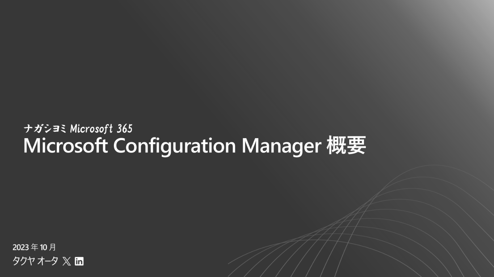

<h1 align="center">
  
</h1>

  <a href="#guides">主要ガイド</a> &nbsp; / &nbsp;
  <a href="#archive">更新履歴・過去版</a> &nbsp; / &nbsp;
  <a href="#session">動画・スライド</a>

---

## このリポジトリについて

日本マイクロソフトの企画・監修のもと、[国井さん](https://azuread.net/)の協力により作成された **Configuration Manager (CB) 評価ガイド**を保管しています。機能やアーキテクチャの理解から環境構築、デバイス管理まで、評価・検証に役立つ日本語のドキュメントです。

> 資料は公開当時の製品名・バージョンに基づいています。現在の仕様とは異なる場合があるため、評価・検証用の参考資料としてご利用ください。

## 主要ガイド

まずはこちらから。目的に合ったガイドを **Word 形式**（.docx）でダウンロードできます。

### 設計・構築

| ガイド | バージョン | 更新 | ダウンロード |
| :--- | :---: | :---: | :---: |
| **機能紹介とアーキテクチャ** | v2.0 | 2017 年 12 月 | [Word ↓](./guides/SCCM_Architect_EvalGuide_jp_v2.0.docx?raw=true) |
| **環境構築** | v1.1 | 2017 年 12 月 | [Word ↓](./guides/SCCM_CB_EvalGuide_jp_v1.1.docx?raw=true) |

### 運用・クラウド連携

| ガイド | バージョン | 更新 | ダウンロード |
| :--- | :---: | :---: | :---: |
| **クラウド管理ゲートウェイ** | v1.1 | 2020 年 3 月 | [Word ↓](./guides/MECM_EvalGuide_CMG_jp_v1.1.docx?raw=true) |
| **Microsoft Defender 管理** | v1.1 | 2020 年 3 月 | [Word ↓](./guides/MECM_EvalGuide_Defender_jp_v1.1.docx?raw=true) |
| **Windows 10 更新プログラム管理** | v1.0 | 2020 年 3 月 | [Word ↓](./guides/MECM_EvalGuide_Update_jp_v1.0.docx?raw=true) |
| **SCCM - Intune 共同管理** | v1.0 | 2019 年 3 月 | [Word ↓](./guides/SCCM_EvalGuide_Co-Management_jp_v1.0.docx?raw=true) |
| **Office 365 ProPlus 展開・アップデート** | v2.0 | 2017 年 12 月 | [Word ↓](./guides/SCCM_EvalGuide_O365ProPlus_jp_v2.0.docx?raw=true) |
| **Windows 10 管理** | v2.0 | 2017 年 12 月 | [Word ↓](./guides/SCCM_EvalGuide_Win10_Management_jp_v2.0.docx?raw=true) |

## 更新履歴・過去版

公開時期ごとの資料一覧です。過去版やモバイル デバイス管理のガイドも、こちらから参照できます。

<strong>更新履歴を開く（2017–2020 年）</strong>

### 2020 年 3 月

| ガイド | バージョン | ダウンロード |
| :--- | :---: | :---: |
| クラウド管理ゲートウェイ | v1.1 | [Word ↓](./guides/MECM_EvalGuide_CMG_jp_v1.1.docx?raw=true) |
| Microsoft Defender 管理 | v1.1 | [Word ↓](./guides/MECM_EvalGuide_Defender_jp_v1.1.docx?raw=true) |
| Windows 10 更新プログラム管理 | v1.0 | [Word ↓](./guides/MECM_EvalGuide_Update_jp_v1.0.docx?raw=true) |

### 2019 年 3 月

| ガイド | バージョン | ダウンロード |
| :--- | :---: | :---: |
| SCCM - Intune 共同管理 | v1.0 | [Word ↓](./guides/SCCM_EvalGuide_Co-Management_jp_v1.0.docx?raw=true) |
| クラウド管理ゲートウェイ | v1.0 | [Word ↓](./guides/SCCM_EvalGuide_CMG_jp_v1.0.docx?raw=true) |
| Windows 10 更新プログラム管理 | v1.0 | [Word ↓](./guides/SCCM_EvalGuide_Update_jp_v1.0.docx?raw=true) |

### 2018 年 3 月

| ガイド | バージョン | ダウンロード |
| :--- | :---: | :---: |
| Windows 10 機能管理 for Fall Creators Update | v1.0 | [Word ↓](./guides/SCCM_EvalGuide_Win10_UpToDate_jp_v1.0.docx?raw=true) |

### 2017 年 12 月

| ガイド | バージョン | ダウンロード |
| :--- | :---: | :---: |
| 機能紹介とアーキテクチャ | v2.0 | [Word ↓](./guides/SCCM_Architect_EvalGuide_jp_v2.0.docx?raw=true) |
| 環境構築 | v1.1 | [Word ↓](./guides/SCCM_CB_EvalGuide_jp_v1.1.docx?raw=true) |
| Office 365 ProPlus 展開・アップデート | v2.0 | [Word ↓](./guides/SCCM_EvalGuide_O365ProPlus_jp_v2.0.docx?raw=true) |
| Windows 10 管理 | v2.0 | [Word ↓](./guides/SCCM_EvalGuide_Win10_Management_jp_v2.0.docx?raw=true) |
| Windows 10 機能管理 for Fall Creators Update | v1.0（ファイル名は v1.1） | [Word ↓](./guides/SCCM_EvalGuide_Win10_UpToDate_jp_v1.1.docx?raw=true) |

### 2017 年 3 月

| ガイド | バージョン | ダウンロード |
| :--- | :---: | :---: |
| 機能紹介とアーキテクチャ | v1.0 | [Word ↓](./guides/SCCM_Architect_EvalGuide_jp_v1.0.docx?raw=true) |
| 環境構築 | v1.0 | [Word ↓](./guides/SCCM_CB_EvalGuide_jp_v1.0.docx?raw=true) |
| モバイル デバイス展開 | v1.0 | [Word ↓](./guides/SCCM_EvalGuide_Intune_Integration_Deployment_jp.docx?raw=true) |
| モバイル デバイス運用管理 | v1.0 | [Word ↓](./guides/SCCM_EvalGuide_Intune_Integration_Management_jp.docx?raw=true) |
| Office 365 ProPlus | v1.0 | [Word ↓](./guides/SCCM_EvalGuide_O365ProPlus_jp_v1.0.docx?raw=true) |
| Windows 10 管理 | v1.0 | [Word ↓](./guides/SCCM_EvalGuide_Win10_Management_jp_v1.0.docx?raw=true) |

## 動画・スライド

### Configuration Manager 概要

**[ナガシヨミ Microsoft 365 - Microsoft Configuration Manager 概要](https://www.docswell.com/s/takuyaot/ZGXWR9-ConfigMgr)**

### Tech Summit 2018 · SCCM 友の会

**System Center Configuration Manager この秋おさえておきたい最新機能!**

2018 年の Tech Summit で、当時の SCCM の最新機能を紹介したセッションです。

**[YouTube で見る →](https://youtu.be/U8CUI3NJEfE)** · **[スライドを読む（PDF）→](./slides/%5BTS18%5D%20PR25%20%20%5BSCCM%20%E5%8F%8B%E3%81%AE%E4%BC%9A%5D%20System%20Center%20Configuration%20Manager%20%E3%81%93%E3%81%AE%E7%A7%8B%E3%81%8A%E3%81%95%E3%81%88%E3%81%A6%E3%81%8A%E3%81%8D%E3%81%9F%E3%81%84%E6%9C%80%E6%96%B0%E6%A9%9F%E8%83%BD.pdf)**

---

  <a href="https://takuyaot01.github.io/">Website</a> &nbsp; / &nbsp;
  <a href="https://github.com/takuyaot01">GitHub</a>

